# NexaGroup Customer Understanding Dashboard

A five-workstream customer intelligence suite for a diversified B2B group — consolidated
customer view, survey sampling design, geography & demography, dealer priority/route plan,
and an editable ROI business case — all chained inside one self-contained HTML file that
opens straight from disk. The five panels read a single embedded dataset, so a figure on
the overview page, a row in the priority list, and a rupee in the business case all come
from the same source of truth.

 &nbsp;
 &nbsp;


Screenshot: `assets/banner.png`

## Quick start

```bash
open index.html          # or: start index.html (Windows) / xdg-open index.html (Linux)
npx serve .              # optional: serve locally
# no install, no build step
```

## Features

- **Customer Understanding** — 616 customers across 19 SBUs; Pareto concentration,
  channel / party / credit mix, recency buckets, monthly trends, SVG Bangladesh
  choropleth with drill-down, CSV + print-ready directory export.
- **Survey Design** — stratified sampling plan (Cochran formula; census for strategic
  accounts) with a sample-size calculator, six-section questionnaire and per-type
  B2B / Distributor / Dealer / B2C modules.
- **Geography & Demography** — standard division → district → upazila geography master,
  interactive map, and a "unlocatable records" coverage diagnosis.
- **Priority List & Route Plan** — 110 dealers ranked by 12-month revenue, grouped by
  division / district / SBU / type for one-trip survey routing, A/B/C tiers, paging and CSV.
- **ROI & Business Case** — editable cost/benefit model with live payback, ROMI and
  scenario outputs.
- One file (~1.8 MB): shell page + five `iframe srcdoc` panels, hand-rolled SVG charting,
  zero runtime dependencies, works offline (Google Fonts are the only optional request).
- Dark data-dense UI per internal design spec: design tokens, Fira Sans / Fira Code,
  KPI hover lift, sticky top bar, focus-visible rings, reduced-motion support,
  responsive at 390 / 768 / 1024 / 1440, light-mode toggle.

## Demo data disclaimer

This is a portfolio copy. All customer names, dealers, distributors, contacts, phone
numbers, addresses, e-mails and business-unit names are **synthetic demo data**
(NexaGroup and its SBUs are fictional); volumes were trimmed. Every panel is marked
"Synthetic demo data". The methodology, information architecture and visuals are the
actual work. See `PROFILE.md` for the research-style write-up.

## Deploy

Import the folder into Vercel as a static project (framework preset "Other", no build,
no output directory) — `index.html` is served as-is.

## License

Personal portfolio use; all demo data is fictional.
